# Multiboot IT Toolkit USB

**One USB flash drive that can repair, rescue, reinstall and test almost any Windows PC.**

Built with **Ventoy**. Plug it in, pick a tool from a menu, and work, even when the PC's own Windows will not start.

> **Author:** 3FAA · **Field:** IT Support / Cybersecurity · **Type:** Personal hands-on project
>
> **Educational project.** All tools belong to their original authors. Use only on devices you own or have written permission to work on.

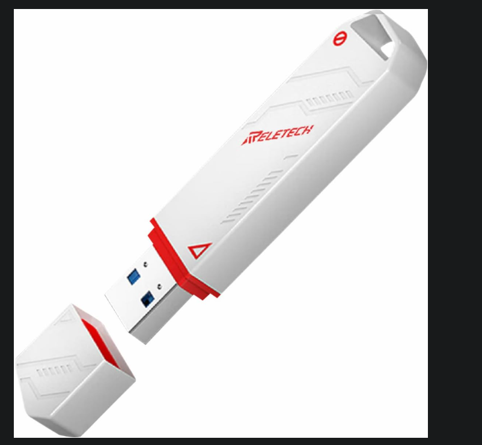

---

## Table of Contents

1. [In plain words (for non-technical readers)](#in-plain-words)
2. [What problems does it solve?](#what-problems-does-it-solve)
3. [What is inside the USB](#what-is-inside-the-usb)
4. [How the USB is built](#how-the-usb-is-built)
5. [How to use it, step by step](#how-to-use-it-step-by-step)
6. [The tools, one by one](#the-tools-one-by-one)
7. [Glossary](#glossary-simple-definitions)
8. [Troubleshooting](#troubleshooting)
9. [Legal and safety notes](#legal-and-safety-notes)
10. [What I learned](#what-i-learned)

---

## In plain words

Imagine your computer will not turn on properly. Windows is broken, a virus took over, or you forgot the password. Normally you would have to take it to a shop.

This USB is like a **mechanic's toolbox for computers**. You plug it in, restart the PC, and instead of starting the broken Windows, the PC starts a **small, temporary system from the USB**. From there you can:

- Get your files back
- Remove viruses
- Erase and set up the disk
- Install a fresh Windows
- Test whether the hardware (RAM, disk) is healthy

Nothing is installed on the PC. When you remove the USB and restart, the PC goes back to normal.

---

## What problems does it solve?

| Problem | Tool on this USB |
|---|---|
| Windows will not start | Windows PE tools (HBCD PE, AnkhTech, Bob Ombs, Medicat) |
| I need to get my files out of a dead PC | Data recovery tools inside the PE environments |
| I want a clean Windows installation | Windows 10 / Windows 7 / Windows Server 2016 installers |
| I want to back up or clone a whole disk | Acronis True Image bootable images |
| I forgot the Windows password | Password tools inside the PE environments |
| Disk is slow or failing | Disk health and testing tools (CrystalDiskInfo, HDD tools) |
| I want to practice security testing (legally) | Kali Linux with saved settings (persistence) |
| I need an ordinary USB to carry files | A separate storage folder on the same drive |

---

## What is inside the USB

The USB has two partitions (this is how Ventoy works):

| Partition | Size | Purpose |
|---|---|---|
| `VTOYEFI` | ~32 MB | Small hidden boot partition (the engine) |
| `FA` (data) | ~119 GB | Where all tools, ISOs and files live |

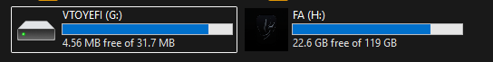

### Folder layout

```
FA (H:)
├── Backup_and_Recovery/      Acronis True Image bootable images (2017, 2021)
├── ISOS Clean Installation/  Windows 10, Windows 7, Windows Server 2016
├── Live OS winPE/            5 rescue systems (see below)
├── Security/                 Kali Linux 2024.2 live
├── persistence/              4 GB file that saves Kali settings
├── USB_Storage/              Normal file storage
├── Downloads/                Extra downloads
├── ventoy/                   Ventoy configuration + custom theme
├── autorun.inf / autorun.ico Custom drive icon
└── VentoyPlugson.txt         Settings for the Ventoy menu
```

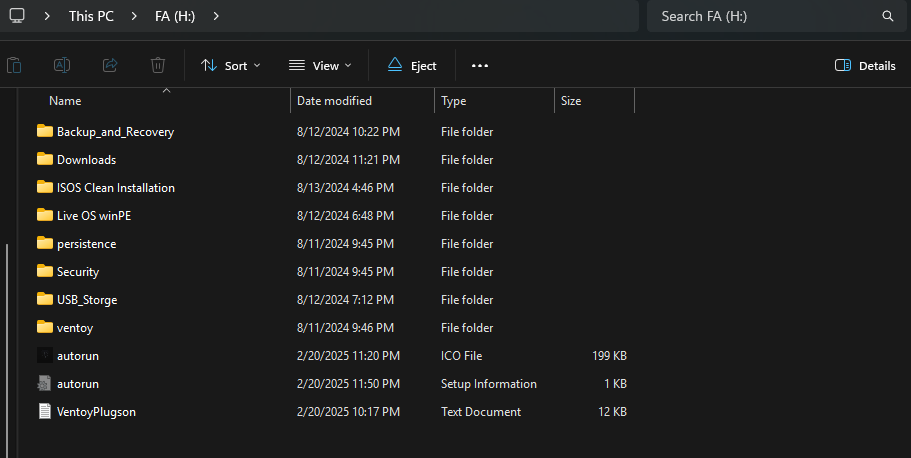

---

## How the USB is built

### 1. Ventoy: the engine

[Ventoy](https://www.ventoy.net) is a free, open-source tool. Normally, making a bootable USB means **erasing it every time** you want a different system. Ventoy is different:

1. Install Ventoy on the USB **one time**.
2. **Copy ISO files** onto the USB like normal files (drag and drop).
3. On boot, Ventoy shows a **menu** with every ISO it finds. Pick one and it starts.

It supports both old (Legacy BIOS) and modern (UEFI) computers, and the USB still works as normal storage.

### 2. Customization

- **Theme:** custom menu look in `ventoy/theme`
- **ventoy.json:** the settings file (themes, persistence, menu names). A backup copy is kept in `ventoy_backup.json`.
- **VentoyPlugson:** a visual editor for the settings, so you do not have to type JSON by hand
- **Persistence:** a 4 GB file (`kali-linux_4GB_persistence.dat`) that lets Kali Linux **remember** files and settings after reboot
- **autorun.inf + icon:** gives the drive a custom name and icon in Windows

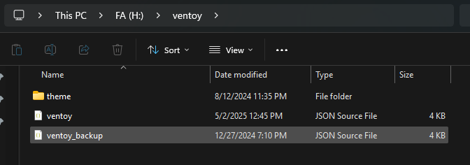
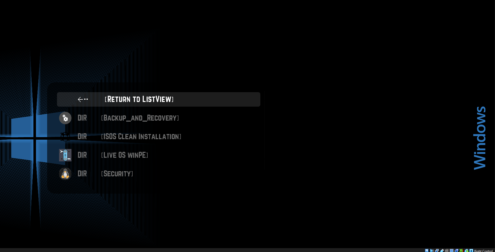

---

## How to use it, step by step

> Always use this on computers **you own or have permission to work on**.

1. **Plug in** the USB.
2. **Restart** the PC and press the boot-menu key right away (depends on the brand: `F12`, `F11`, `F9`, `Esc` or `F2`).
3. **If it refuses to boot:** open BIOS/UEFI settings and **turn off Secure Boot** (Ventoy also supports Secure Boot with a one-time key enrollment, but turning it off is the simplest way).
4. Choose the **USB drive** as the boot device (or move it to the top of the **boot order**).
5. The **Ventoy menu** appears. Use the arrow keys and press `Enter` on the tool you want.
6. When you finish, shut down, remove the USB, and boot normally.

---

## The tools, one by one

### A. Live OS (WinPE): "a mini Windows that runs from the USB"

**WinPE** (Windows Preinstallation Environment) is a small version of Windows that runs from the USB and from the computer's memory (RAM). It has a normal-looking desktop, a Start menu and a collection of repair tools. Because it does not use the PC's own Windows, it works even when that Windows is broken.

This USB has **five** different WinPE systems. They are alternatives, because each one includes slightly different tools.

#### 1. Hiren's BootCD PE (`HBCD_PE_x64`)
- **Link:** [https://www.hirensbootcd.org](https://www.hirensbootcd.org/) · [Screenshots](https://www.hirensbootcd.org/screenshots/)
- **What it is:** a modern revival of the famous *Hiren's BootCD*, built on Windows PE (Windows 11 PE in recent versions). The original stopped updating in 2012, so fans continue it.
- **Good for:** the best "first choice" for beginners. Clean, popular and well documented.
- **Tools included (examples):**
  - Data recovery: Recuva, PhotoRec, DMDE, Puran File Recovery
  - Disk health: CrystalDiskInfo, HDDScan, GSmartControl
  - Backup/cloning: Macrium Reflect, Acronis True Image
  - Boot repair: BootIce, EasyBCD
  - Hardware info: CPU-Z, HWiNFO
  - Malware scanning: Malwarebytes, ESET Online Scanner
- **Needs:** a 64-bit PC with UEFI boot and at least 4 GB RAM (according to the official site). It also tries to install network drivers automatically so Wi-Fi/Ethernet can work.

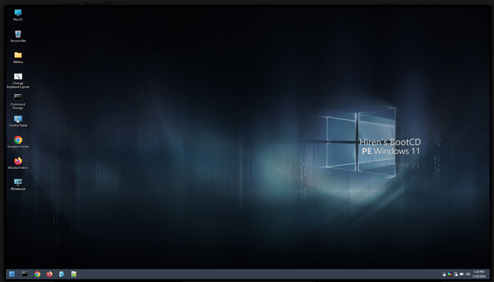
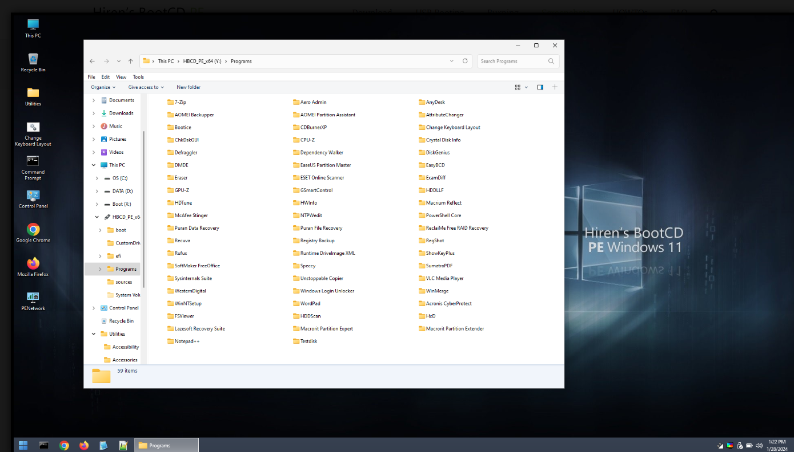

#### 2. Medicat USB (`Medicat_USB_v2`)
- **Link:** [AlternativeTo project page](https://www.alternativeto.net/software/medicat-dvd/about/) (listed there as discontinued, so check its current status)
- **What it is:** a complete **PC repair toolkit** also built on Ventoy. Its main menu groups tools into categories: Windows boot tools, partition tools, diagnostic tools, antivirus, data recovery and Linux utilities.
- **Good for:** the "do everything" option. It also includes Linux-based tools and memory testing.
- **Size:** very large (~29 GB), because it contains many environments in one.

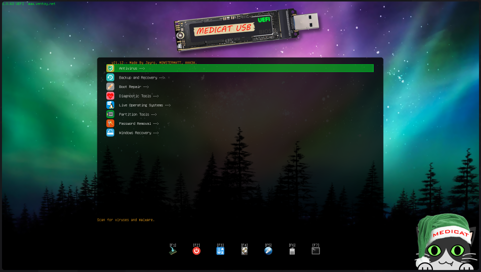
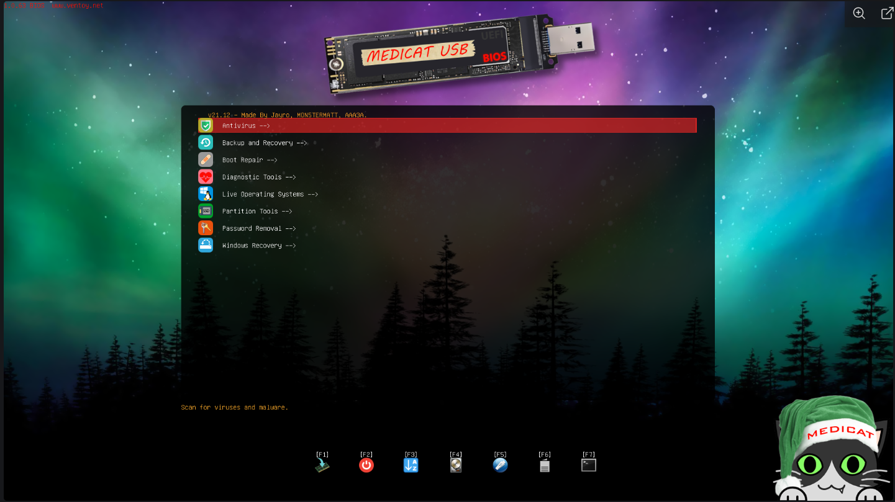

#### 3. AnkhTech WinPE (`Win10PE.AnkhTech.V10`)
- **Link:** [https://ankhtech.org/winpe.html](https://ankhtech.org/winpe.html)
- **What it is:** a Windows 10 PE rescue system built by the AnkhTech community, an alternative to Hiren's BootCD and Sergei Strelec's WinPE.
- **Good for:** disk management, backup and restore, hardware testing and changing local Windows passwords. Press the **Windows key** (or use the launcher) to open the program list.
- **Tools included (examples):** Q-Dir file explorer, 7-Zip, BOOTICE, HWiNFO, CPU-Z, CrystalDiskInfo, CrystalDiskMark, partition manager, RAM test, user password changer.

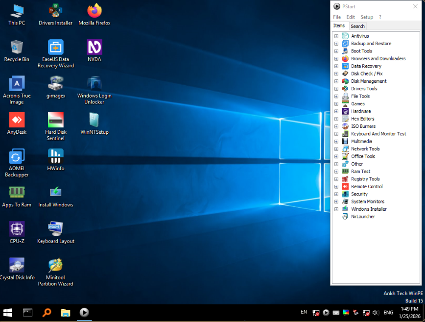
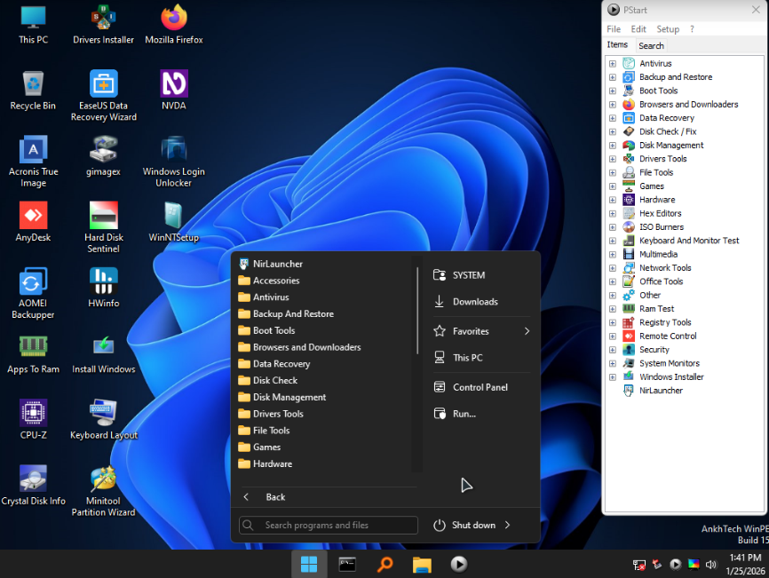

#### 4. Bob Ombs Modified Win10PE x64 (`Bob.Ombs.Modified.Win10PEx64.v4.98`)
- **Link:** no official website. Source pages: [Internet Archive](https://archive.org/details/bob-ombs-windows-10-pe-iso) · [MakeUseOf review](https://www.makeuseof.com/tag/bootable-windows-pe-based-recovery-discs/)
- **What it is:** a community-modified Windows 10 PE (64-bit). Builds like this are usually made with a "Win10PE SE / Win10XPE" builder project, which creates a lightweight Windows PE from an official Windows 10 disc and adds free tools.
- **Good for:** general rescue work, with a normal Windows-like desktop and a built-in app menu.

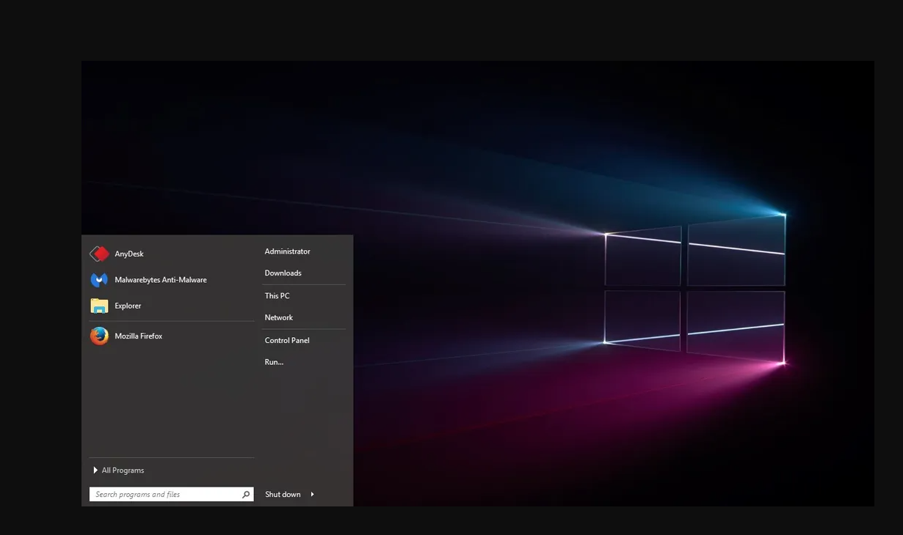

#### 5. WinPE x64 (`WinPE_x64`)
- **Link:** [Microsoft: Windows PE introduction](https://learn.microsoft.com/windows-hardware/manufacture/desktop/winpe-intro)
- **What it is:** a **minimal** 64-bit Windows PE. It is small (~380 MB), loads fast and has fewer tools.
- **Good for:** quick jobs, older/low-RAM computers, or when you just need a command prompt and disk tools.

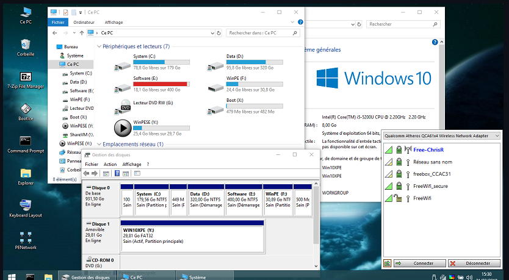

---

### B. Clean Windows installers (`ISOS Clean Installation`)

| File | What it is | Use |
|---|---|---|
| `Windows10` | Windows 10 installer | Fresh install on modern PCs |
| `windows7` | Windows 7 installer | Old PCs / legacy testing |
| `Windows_Server_2016_Datacenter_EVAL` | Windows Server 2016 (evaluation) | Server practice, home labs |

Ventoy boots the installer directly from the ISO, with no need to burn a separate USB for each Windows.

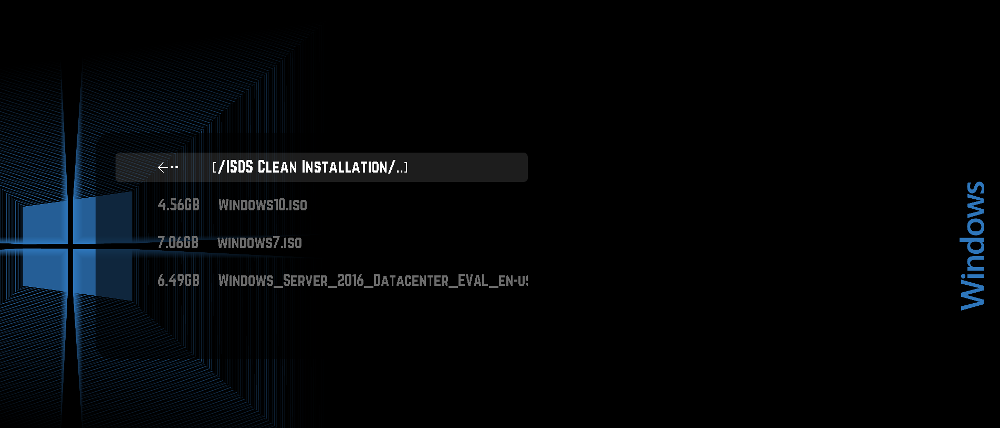
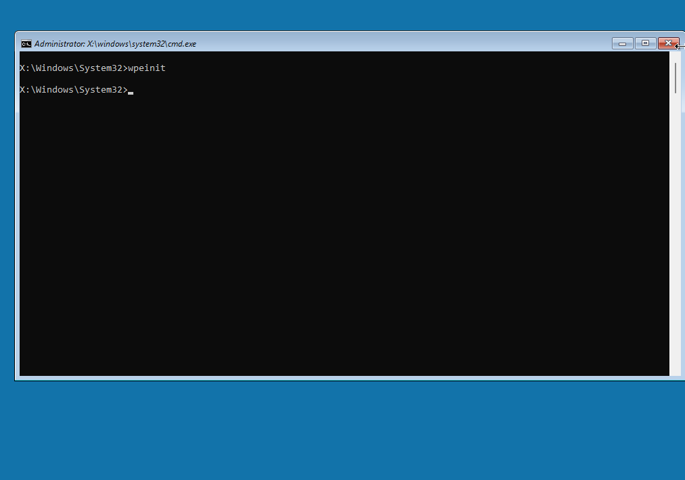

---

### C. Backup and recovery (`Backup_and_Recovery`)

**Acronis True Image** (2017 and 2021 bootable images). Use it to make a full copy ("image") of a disk, and restore it later or clone it to a new drive. This is the safest way to move from an old hard drive to a new SSD.

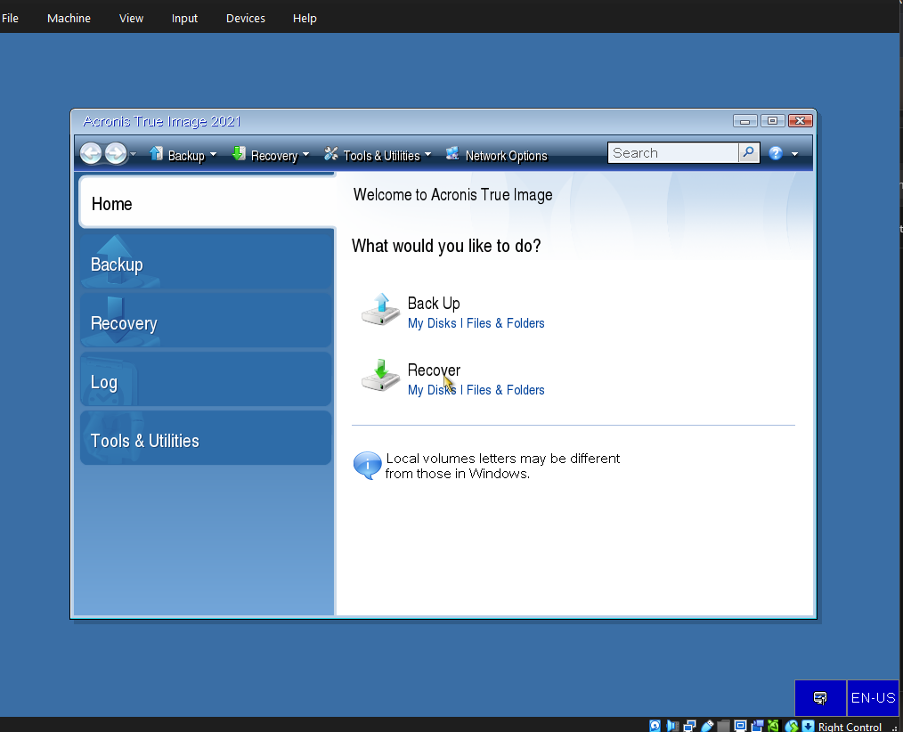
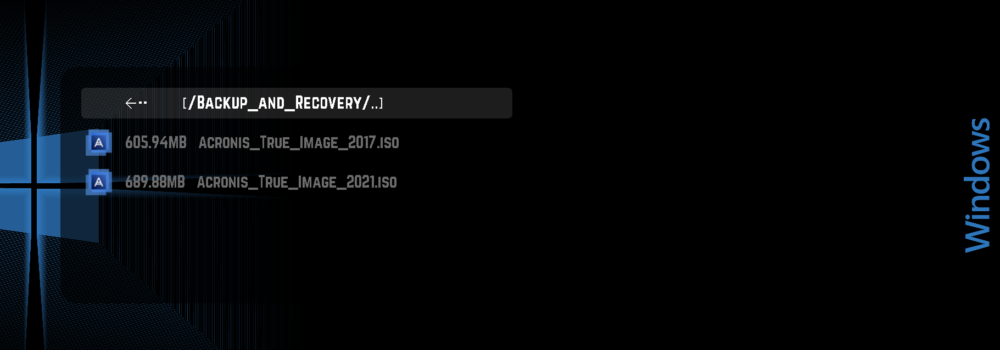

---

### D. Security (`Security` + `persistence`)

**Kali Linux 2024.2 (live)** is a Linux system made for security learning and testing (network testing, forensics, password auditing). It runs from the USB and does not touch the PC.

- **Persistence:** normally a live system forgets everything on reboot. The 4 GB persistence file lets Kali **save** files, settings and installed tools between sessions.
- Use these tools only on systems you own or have written permission to test.

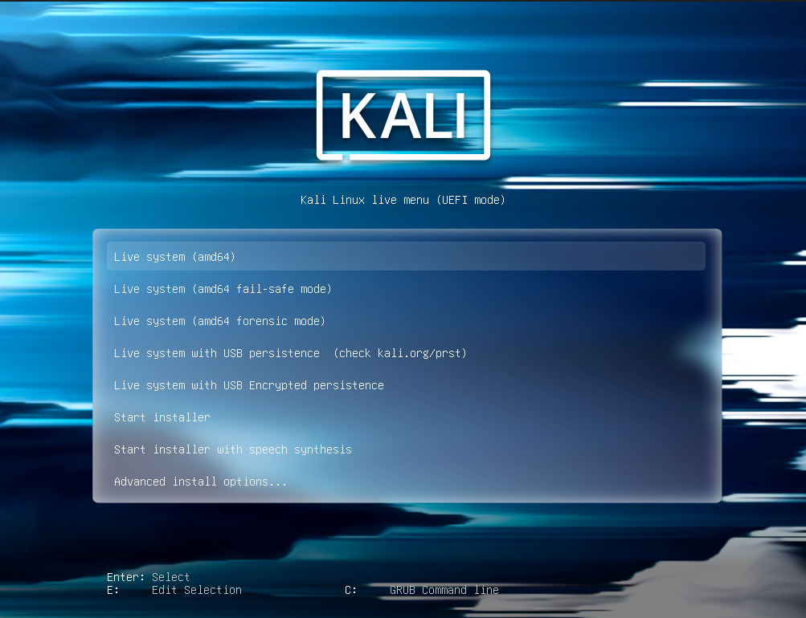
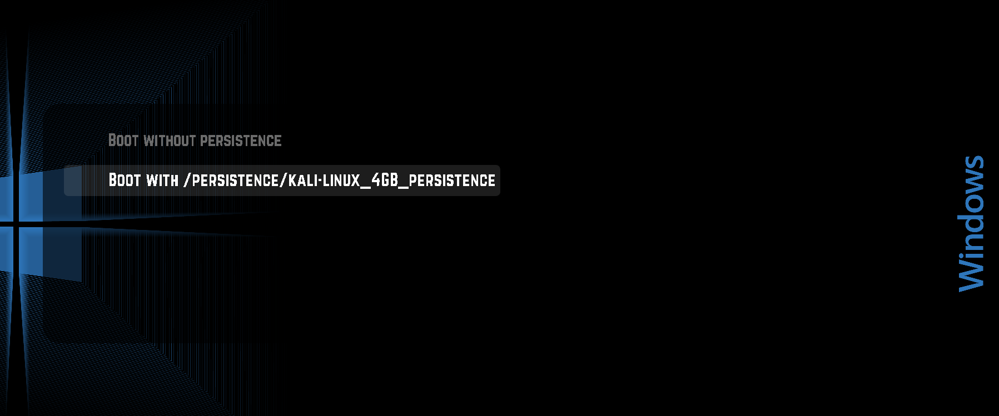

---
## Testing and Screenshots

Every tool in this project was tested in a virtual machine (VirtualBox) so the real computer was never touched. The folder views were captured on the real PC. Screenshots are stored in the `screenshots` folder of this repository.

### Screenshot index

| File | What it shows | Section of this README | Taken on |
|---|---|---|---|
| `00-usb-drive.png` | The physical USB drive | Top of the page | Photo |
| `01-partitions.png` | Explorer showing `VTOYEFI` and `FA` | What is inside the USB | Real PC |
| `02-main-folders.png` | Root folder list of the USB | What is inside the USB | Real PC |
| `03-ventoy-folder.png` | Contents of the `ventoy` folder | How the USB is built | Real PC |
| `04-ventoy-boot-menu.png` | Ventoy boot menu with the custom theme | How the USB is built | Real PC or VM |
| `10-hbcd-desktop.png` | Hiren's BootCD PE desktop | A.1 Hiren's BootCD PE | VM |
| `11-hbcd-tools.png` | Hiren's tools menu open | A.1 Hiren's BootCD PE | VM |
| `12-medicat-menu.png` | Medicat main menu | A.2 Medicat USB | VM |
| `13-medicat-tools.png` | One Medicat tool running | A.2 Medicat USB | VM |
| `14-ankhtech-desktop.png` | AnkhTech WinPE desktop | A.3 AnkhTech WinPE | VM |
| `15-ankhtech-programs.png` | AnkhTech program list (Windows key) | A.3 AnkhTech WinPE | VM |
| `16-bobombs-desktop.png` | Bob Ombs Win10PE desktop | A.4 Bob Ombs Win10PE | VM |
| `17-winpe-desktop.png` | WinPE x64 desktop | A.5 WinPE x64 | VM |
| `20-installers-folder.png` | `ISOS Clean Installation` folder | B. Clean Windows installers | Real PC |
| `21-windows-setup.png` | First screen of Windows setup | B. Clean Windows installers | VM |
| `30-backup-folder.png` | `Backup_and_Recovery` folder | C. Backup and recovery | Real PC |
| `31-acronis.png` | Acronis True Image main screen | C. Backup and recovery | VM |
| `40-kali-desktop.png` | Kali Linux desktop | D. Security | VM |
| `41-kali-persistence.png` | Kali persistence option or a saved file after reboot | D. Security | VM |


## Glossary (simple definitions)

| Term | Simple meaning |
|---|---|
| **USB boot** | Starting the computer from the USB instead of its own disk |
| **ISO** | A single file that contains a whole disc (like a digital DVD) |
| **Ventoy** | The tool that lets one USB hold many ISOs and shows a menu |
| **WinPE** | A small temporary Windows that runs from the USB, used for repairs |
| **BIOS / UEFI** | The first screen of the PC (before Windows) where you change boot settings |
| **Secure Boot** | A BIOS feature that blocks unknown boot programs, sometimes needs to be off |
| **Boot order** | The list that decides which device the PC starts from first |
| **Persistence** | A saved file that lets a live system remember your changes |
| **Disk image / clone** | An exact copy of a whole disk |
| **Partition** | A section of a disk (like rooms in a house) |

---

### Official sources
- Ventoy: https://www.ventoy.net
- Hiren's BootCD PE: https://www.hirensbootcd.org
- Medicat USB: https://www.alternativeto.net/software/medicat-dvd/about/
- AnkhTech WinPE: https://ankhtech.org/winpe.html
- Bob Ombs Win10PE: https://archive.org/details/bob-ombs-windows-10-pe-iso (no official site)
- Windows PE (Microsoft): https://learn.microsoft.com/windows-hardware/manufacture/desktop/winpe-intro
- Kali Linux: https://www.kali.org
- Microsoft Windows downloads: https://www.microsoft.com/software-download

---

## What I learned

- How the **boot process** works (BIOS/UEFI, boot order, Secure Boot)
- How to build and customize a **multiboot USB** with Ventoy
- Difference between **installers**, **live systems** and **WinPE rescue environments**
- Basics of **data recovery, disk imaging and cloning**
- Using **Kali Linux persistence** safely for learning
- Testing every tool inside a **virtual machine** and documenting it clearly

